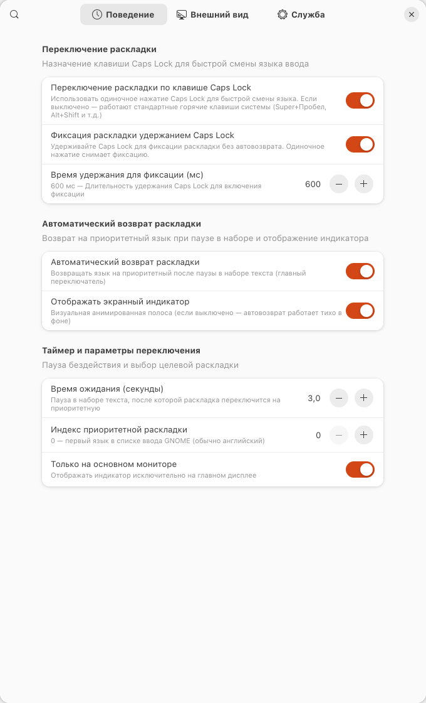
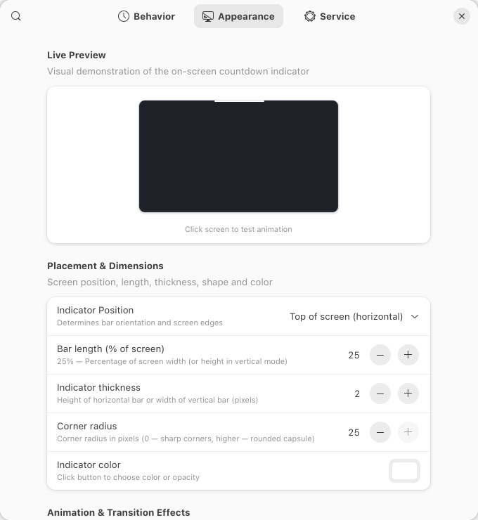
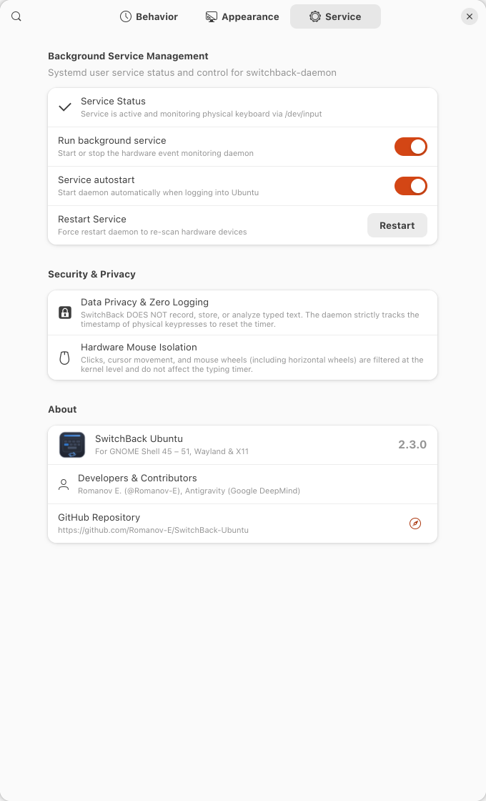
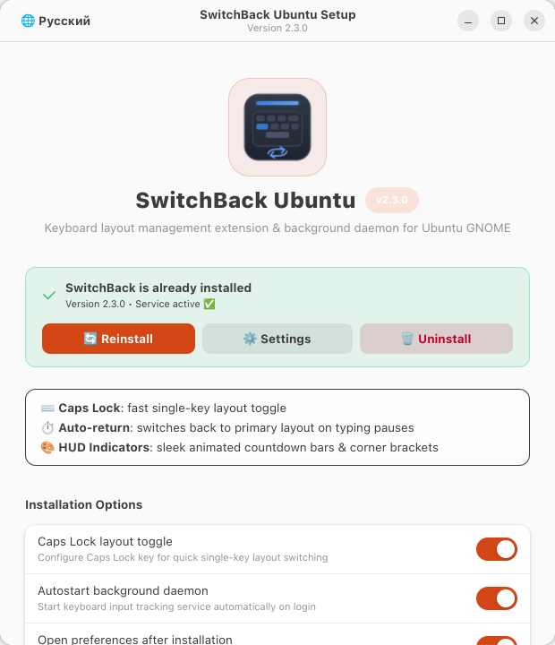
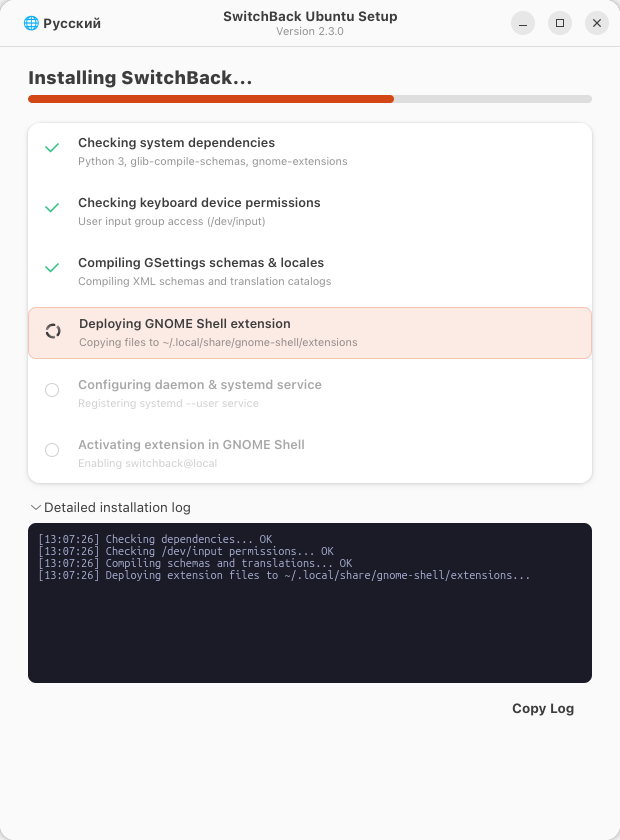

<p align="right">
  <b>English 🇬🇧</b> | <a href="README.ru.md">Русский 🇷🇺</a>
</p>

<div align="center">
  
  <h1>SwitchBack Ubuntu 🔄</h1>
  <p>Keyboard layout management extension & background daemon for Ubuntu GNOME 🚀⌨️</p>

  <p>
    <a href="https://extensions.gnome.org/"></a>
    <a href="#architecture"></a>
    <a href="https://ubuntu.com"></a>
    <a href="https://github.com/Romanov-E"></a>
    <a href="LICENSE"></a>
  </p>
</div>

**SwitchBack Ubuntu** is a keyboard layout management extension and background daemon for Ubuntu GNOME (Wayland and X11), inspired by the Windows utility [*Switchify*](https://github.com/JD72/Switchify) by [JD72](https://github.com/JD72).

It adds single-key layout switching via `Caps Lock`, customizable on-screen countdown bars, and automatic return to your primary input language after typing pauses.

---

## ✨ Features

- **Caps Lock Toggle:** Single-key layout toggle using `Caps Lock`. Standard system shortcuts (`Super+Space`, `Alt+Shift`) remain available when disabled.
- **Inactivity Auto-Return:** Switches back to your primary layout (e.g., English) after a configurable pause in typing (0.5 to 30 seconds).
- **On-Screen Indicators:**
  - **Placements:** Top, Bottom, Dual Top + Bottom, Left, Right, Dual Left + Right, Corner L-brackets (all 4 individual corners and simultaneous 4-corner HUD).
  - **Independent Margins:** Pixel-accurate offsets for top, bottom, left, and right screen edges.
  - **Geometry:** Configurable thickness (1–40 px), length (5% to 100%), and corner radius (up to full pill shape).
  - **Color & Alpha:** Full GTK color palette with RGBA opacity support.
  - **Animations & Effects:** 6 motion styles (collapse to center, split outward to edges, fill from center outward, converge from edges to center, collapse to start, and collapse to end), master transition fade slider (0–2000 ms), and optional separate timing controls for entrance fade-in (0–1000 ms) and exit fade-out (0–2000 ms).
  - **16:9 Live Preview:** High-framerate proportional monitor preview synchronized with display VSync.
- **Hardware Event Filtering:**
  - Reads Linux kernel input events directly via `/dev/input/event*`.
  - Mouse movements, clicks, and scroll wheels (including horizontal wheels on mice like Logitech MX Master) do not reset the typing timer.
- **Privacy & Security:**
  - Does not log, store, or inspect typed keystrokes. The daemon only reads `EV_KEY` events to record a monotonic timestamp.
  - Runs as a user-level service (`systemd --user`) without root privileges.
  - IPC memory file (`/dev/shm/switchback_key`) is restricted to owner permissions (`0600`).
- **Service Management:** Built-in controls in the preferences window to start, stop, restart, and inspect the background daemon.

---

## 📸 Interface & Live Preview Animations

### Preferences Window Tabs

<div align="center">

| Tab 1: Behavior | Tab 2: Appearance | Tab 3: Service |
| :---: | :---: | :---: |
|  |  |  |

</div>

### Live Indicator Preview Animations

<div align="center">

| Top Screen Edge — Contract to Center (White) | Top-Right Corner — L-Bracket (Ubuntu Orange) |
| :---: | :---: |
|  |  |

| Bottom Screen Edge — Expand to Edges (Green) | All 4 Corners HUD (Cyber Cyan) |
| :---: | :---: |
|  |  |

| Dual Top & Bottom Bars (Amber Gold) | Dual Left & Right Bars (Cyber Purple) |
| :---: | :---: |
|  |  |

</div>

---

## 🏗️ Architecture

```
                  ┌──────────────────────────────────────────────┐
                  │          Physical Keyboard (/dev/input)      │
                  └──────────────────────┬───────────────────────┘
                                         │ EV_KEY events only
                                         ▼
                  ┌──────────────────────────────────────────────┐
                  │       SwitchBack Daemon (systemd --user)     │
                  │   Filters out all mouse clicks and movements │
                  └──────────────────────┬───────────────────────┘
                                         │ Monotonic timestamp (0600)
                                         ▼
                  ┌──────────────────────────────────────────────┐
                  │        Shared Memory RAM (/dev/shm)          │
                  └──────────────────────┬───────────────────────┘
                                         │ Instant zero-overhead read
                                         ▼
                  ┌──────────────────────────────────────────────┐
                  │        GNOME Shell Extension (Wayland / X11) │
                  │    • 60 FPS Clutter / St indicator           │
                  │    • Auto-switch via InputSourceManager      │
                  │    • Live GSettings sync with GTK4 Prefs GUI │
                  └──────────────────────────────────────────────┘
```

---

## 🚀 Installation

Clone the repository and choose your preferred installation method:

```bash
git clone https://github.com/Romanov-E/SwitchBack-Ubuntu.git
cd SwitchBack-Ubuntu
```

### Option A: Graphical Installer (Recommended)

**Fast one-line launch (without manual download):**
```bash
wget -qO- https://github.com/Romanov-E/SwitchBack-Ubuntu/releases/latest/download/SwitchBack-Ubuntu-v2.3.0.tar.gz | tar xz && cd SwitchBack-Ubuntu-v2.3.0 && ./install-gui
```

Or from a cloned repository:
```bash
./install-gui
# or: ./install.sh --gui
```
*(You can also double-click `SwitchBack-Installer.desktop` directly in Ubuntu Files / Nautilus)*

Supports fresh setup, configuring startup options, opening preferences, and cleanly reinstalling or removing SwitchBack at any time.

<div align="center">

| Setup Options | Live Progress & Log |
| :---: | :---: |
|  |  |

</div>

### Option B: Terminal Script

**Fast one-line install (no git or manual download required):**
```bash
wget -qO- https://github.com/Romanov-E/SwitchBack-Ubuntu/releases/latest/download/SwitchBack-Ubuntu-v2.3.0.tar.gz | tar xz && cd SwitchBack-Ubuntu-v2.3.0 && ./install.sh
```

Or run the automated CLI script from a cloned repository:
```bash
./install.sh
```

### What the installer does:
1. Verifies dependencies (`python3`, `glib-compile-schemas`, `gnome-extensions`).
2. Adds the current user to the system `input` group for kernel event access without root.
3. Compiles GSettings schemas and installs the GNOME Shell extension.
4. Registers and starts the `systemd --user` background daemon.
5. Enables the extension.

> **Note:** If your user was just added to the `input` group, log out of your desktop session and log back in for kernel group permissions to take effect.

---

## ⚙️ Configuration & Settings

Open preferences through:
- **GNOME Extensions App:** Click the settings gear next to **SwitchBack Ubuntu**.
- **Terminal:**
  ```bash
  gnome-extensions prefs switchback@romanov-e
  ```

All settings apply in real time without restarting GNOME Shell.

---

## 🗑️ Uninstallation

To remove SwitchBack and all associated files:

```bash
cd SwitchBack-Ubuntu
./uninstall.sh
```

---

## 🙏 Acknowledgments

- Inspired by the Windows utility [Switchify](https://github.com/JD72/Switchify) created by [JD72](https://github.com/JD72).

---

## 👥 Authors & Contributors

- **Romanov E.** ([@Romanov-E](https://github.com/Romanov-E)) — Author & Lead Developer
- **Antigravity** ([Google DeepMind](https://deepmind.google)) — AI Pair Programmer & Co-developer (system architecture, `/dev/input` hardware event daemon, animation mathematics, GNOME Shell extension & UI/UX)

---

## 📄 License

Distributed under the GNU General Public License v3.0 (GPLv3). See [LICENSE](LICENSE) for details.
Authors: [Romanov-E](https://github.com/Romanov-E) & contributors.

---

<div align="center">

<a href="https://deepmind.google/technologies/gemini/">
  
</a>

<br/><br/>

<a href="https://deepmind.google/technologies/gemini/">
  
</a>
&nbsp;
<a href="https://deepmind.google">
  
</a>

<br/><br/>

<p><sub>Assisted by <b>Google Gemini</b> & <b>Google DeepMind Antigravity</b></sub></p>

</div>
