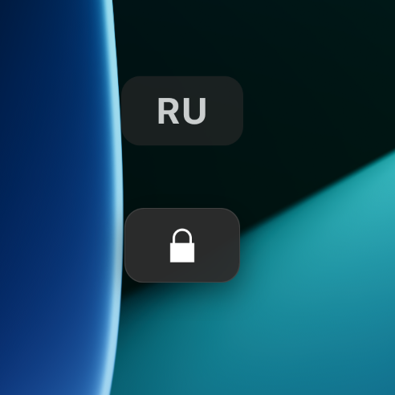
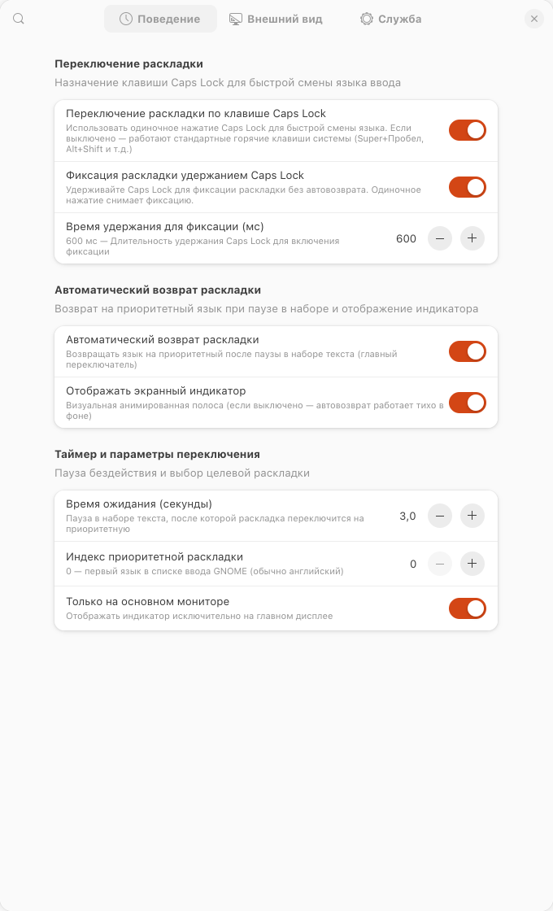
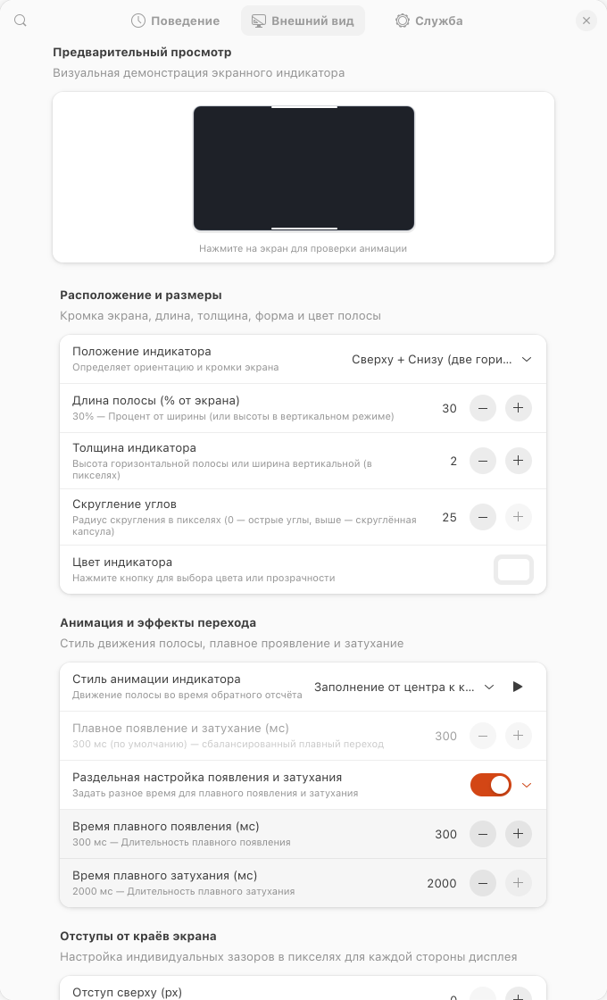
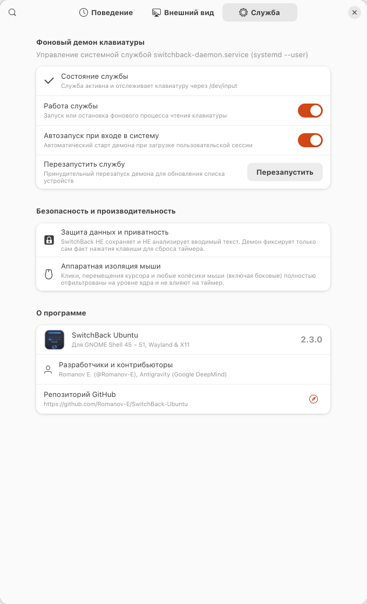
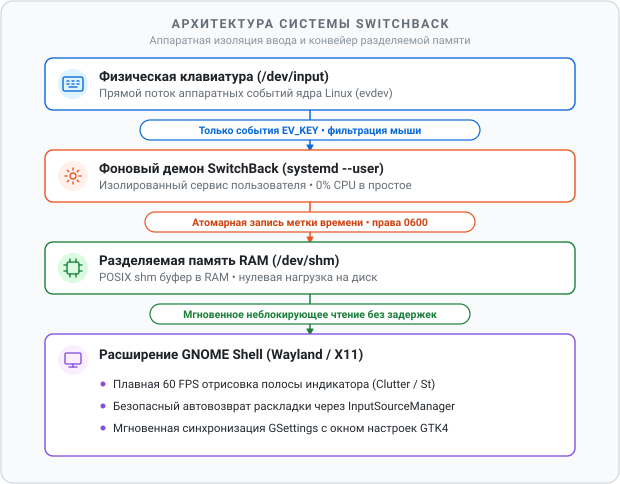
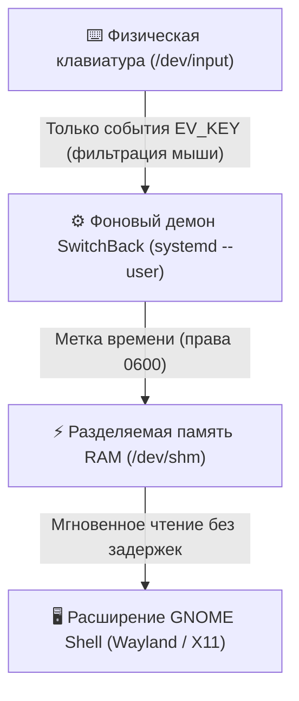
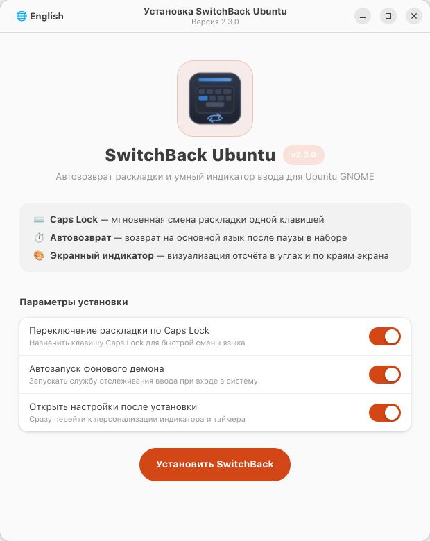
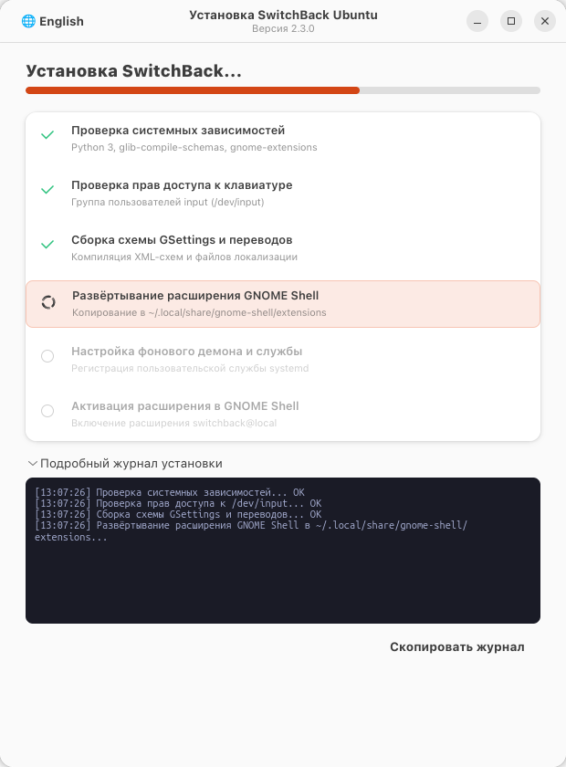

<p align="right">
  <a href="README.md">English 🇬🇧</a> | <b>Русский 🇷🇺</b>
</p>

<div align="center">
  
  <h1>SwitchBack Ubuntu 🔄</h1>
  <p>Расширение GNOME Shell и фоновый демон автопереключения раскладки для Ubuntu 🚀⌨️</p>

  <p>
    <a href="https://extensions.gnome.org/"></a>
    <a href="#архитектура"></a>
    <a href="https://ubuntu.com"></a>
    <a href="https://github.com/Romanov-E"></a>
    <a href="LICENSE"></a>
  </p>
</div>

**SwitchBack Ubuntu** — расширение для GNOME Shell и фоновый демон для автоматического возврата на приоритетную раскладку клавиатуры в Ubuntu (Wayland и X11), созданные по мотивам утилиты [*Switchify*](https://github.com/JD72/Switchify) автора [JD72](https://github.com/JD72).

Проект добавляет переключение раскладки по нажатию `Caps Lock`, экранную полосу обратного отсчёта с гибкой кастомизацией и автоматический возврат на основной язык (например, английский) после завершения ввода.

---

## ✨ Возможности

- **Переключение и фиксация раскладки по Caps Lock:** Быстрая смена языка по клавише `Caps Lock`. Удержание Caps Lock (по умолчанию 300 мс, настраивается от 150 до 2000 мс) временно фиксирует текущую неприоритетную раскладку, отключая автовозврат; одиночное нажатие снимает фиксацию. Нативные экранные индикаторы в стиле Ubuntu (`🔒` / `🔓`), опция постоянного значка замка на экране и возможность скрывать экранные полосы во время фиксации.
- **Автовозврат при бездействии:** Переключение на приоритетную раскладку после паузы в наборе текста (от 0.5 до 30 секунд).
- **Экранный индикатор:**
  - **Расположение:** Сверху, Снизу, Парные полосы Сверху + Снизу, Слева, Справа, Парные Слева + Справа, Угловые Г-образные индикаторы (все 4 угла по отдельности и синхронно все 4 угла).
  - **Индивидуальные отступы:** Точная настройка зазоров от каждой кромки экрана в пикселях с относительным отображением в окне превью.
  - **Геометрия:** Настройка толщины (1–40 px), длины (5%–100%) и радиуса скругления углов.
  - **Цвет и прозрачность:** Поддержка системной палитры и RGBA с прозрачностью.
  - **Анимация и эффекты:** 6 стилей движения (сжатие к центру, распадение к краям, заполнение от центра к краям, от краёв к центру с обоих сторон, сжатие к началу и к концу), единая настройка плавности перехода (0–2000 мс), а также опциональная раздельная настройка появления (Fade-In 0–1000 мс) и затухания (Fade-Out 0–2000 мс).
  - **Закреплённое 16:9 превью:** Макет монитора реальных пропорций с аппаратной синхронизацией частоты кадров (VSync) и визуализацией относительных отступов, зафиксированный в верхней части вкладки при прокрутке списка параметров.
- **Аппаратная фильтрация событий ввода:**
  - Чтение событий клавиатуры напрямую через `/dev/input/event*`.
  - Движения курсора, клики мыши и прокрутка колёсика (включая горизонтальное колесо) не сбрасывают таймер ввода.
- **Безопасность и приватность:**
  - Не выполняет запись или анализ вводимого текста. Демон фиксирует исключительно факт нажатия клавиш (`EV_KEY`) для обновления монотонной метки времени.
  - Работает в пользовательском пространстве (`systemd --user`) без root-прав.
  - Файл разделяемой памяти (`/dev/shm/switchback_key`) защищён правами `0600` (только для владельца).
- **Управление службой:** Встроенные элементы управления в окне настроек для проверки статуса, запуска, остановки и перезапуска демона.

---

## 📸 Интерфейс и анимации визуализации

### Индикатор блокировки и вкладки настроек

<div align="center">

| Индикатор блокировки (стиль Ubuntu) | Вкладка 1: Поведение | Вкладка 2: Внешний вид | Вкладка 3: Служба |
| :---: | :---: | :---: | :---: |
|  |  |  |  |

</div>

### Анимации визуализации индикатора на экране превью

<div align="center">

| Сверху экрана — Сжатие к центру (Белый) | Верхний правый угол — Г-образный (Ubuntu Orange) |
| :---: | :---: |
|  |  |

| Снизу экрана — К краям (Изумрудно-зелёный) | Все 4 угла экрана — HUD (Неоновый циан) |
| :---: | :---: |
|  |  |

| Сверху и снизу экрана (Янтарное золото) | Слева и справа экрана (Кибер-фиолетовый) |
| :---: | :---: |
|  |  |

</div>

---

## 🏗️ Архитектура

<div align="center">
  
</div>

| Компонент | Уровень | Описание |
| :--- | :--- | :--- |
| **Физическая клавиатура** | `/dev/input/event*` | Прямой поток аппаратных событий ядра Linux (evdev); фиксирует нажатия клавиш без задержек. |
| **Фоновый демон** | `systemd --user` | Пользовательский сервис; полностью отфильтровывает мышь и записывает монотонную метку времени. |
| **Разделяемая память** | `/dev/shm` (0600) | Буфер в оперативной памяти (POSIX shm); мгновенный обмен данными без нагрузки на диск и процессор. |
| **Расширение Shell** | Wayland / X11 | Плавная 60 FPS отрисовка индикатора (Clutter), безопасный автовозврат раскладки и синхронизация с GTK4. |

<details>
<summary><b>Показать текстовую схему (Mermaid)</b></summary>


</details>

---

## 🚀 Установка

Склонируйте репозиторий и выберите удобный способ установки:

```bash
git clone https://github.com/Romanov-E/SwitchBack-Ubuntu.git
cd SwitchBack-Ubuntu
```

### Способ А: Графический установщик (Рекомендуется)

**Быстрый запуск одной командой (без ручного скачивания архива):**
```bash
wget -qO- https://github.com/Romanov-E/SwitchBack-Ubuntu/releases/latest/download/SwitchBack-Ubuntu-v2.5.0.tar.gz | tar xz && cd SwitchBack-Ubuntu-v2.5.0 && ./install-gui
```

Либо из склонированного репозитория:
```bash
./install-gui
# или: ./install.sh --gui
```
*(Также можно просто дважды кликнуть по файлу `SwitchBack-Installer.desktop` в проводнике «Файлы»)*

Позволяет выполнить установку, настроить автозапуск, перейти в настройки, а также в один клик безопасно переустановить или удалить SwitchBack в любой момент.

<div align="center">

| Экран параметров установки | Процесс установки и журнал |
| :---: | :---: |
|  |  |

</div>

### Способ Б: Установка через терминал

**Быстрая установка одной командой (без git и ручной распаковки):**
```bash
wget -qO- https://github.com/Romanov-E/SwitchBack-Ubuntu/releases/latest/download/SwitchBack-Ubuntu-v2.5.0.tar.gz | tar xz && cd SwitchBack-Ubuntu-v2.5.0 && ./install.sh
```

Либо запуск скрипта из склонированного репозитория:
```bash
./install.sh
```

### Действия установщика:
1. Проверяет наличие зависимостей (`python3`, `glib-compile-schemas`, `gnome-extensions`).
2. Добавляет пользователя в группу `input` для доступа к устройствам ввода без root-прав.
3. Компилирует схему GSettings и устанавливает расширение GNOME Shell.
4. Регистрирует и запускает пользовательскую службу `systemd --user`.
5. Включает расширение.

> **Примечание:** Если пользователя только что добавили в группу `input`, выполните выход из сеанса системы (Log Out) и войдите повторно.

---

## ⚙️ Настройка

Параметры открываются через:
- **Приложение «Расширения» GNOME:** Кнопка шестерёнки рядом с **SwitchBack Ubuntu**.
- **Терминал:**
  ```bash
  gnome-extensions prefs switchback@romanov-e
  ```

Изменения применяются мгновенно без перезапуска сессии GNOME Shell.

---

## 🗑️ Удаление

Для полного удаления SwitchBack и его компонентов:

```bash
cd SwitchBack-Ubuntu
./uninstall.sh
```

---

## 🙏 Благодарности

- Проект вдохновлён утилитой [Switchify](https://github.com/JD72/Switchify) для Windows автора [JD72](https://github.com/JD72).

---

## 👥 Авторы и контрибьюторы

- **Romanov E.** ([@Romanov-E](https://github.com/Romanov-E)) — Автор проекта и ведущий разработчик
- **Antigravity** ([Google DeepMind](https://deepmind.google)) — AI Pair Programmer & Соавтор (системная архитектура, модуль перехвата ввода `/dev/input`, математика анимаций, расширение GNOME Shell и дизайн UI/UX)

---

## 📄 Лицензия

Распространяется под лицензией GNU General Public License v3.0 (GPLv3). Подробнее см. в файле [LICENSE](LICENSE).
Авторы: [Romanov-E](https://github.com/Romanov-E) и контрибьюторы.

---

<div align="center">

<a href="https://deepmind.google/technologies/gemini/">
  
</a>

<br/><br/>

<a href="https://deepmind.google/technologies/gemini/">
  
</a>
&nbsp;
<a href="https://deepmind.google">
  
</a>

<br/><br/>

<p><sub>Разработано при содействии <b>Google Gemini</b> & <b>Google DeepMind Antigravity</b></sub></p>

</div>
